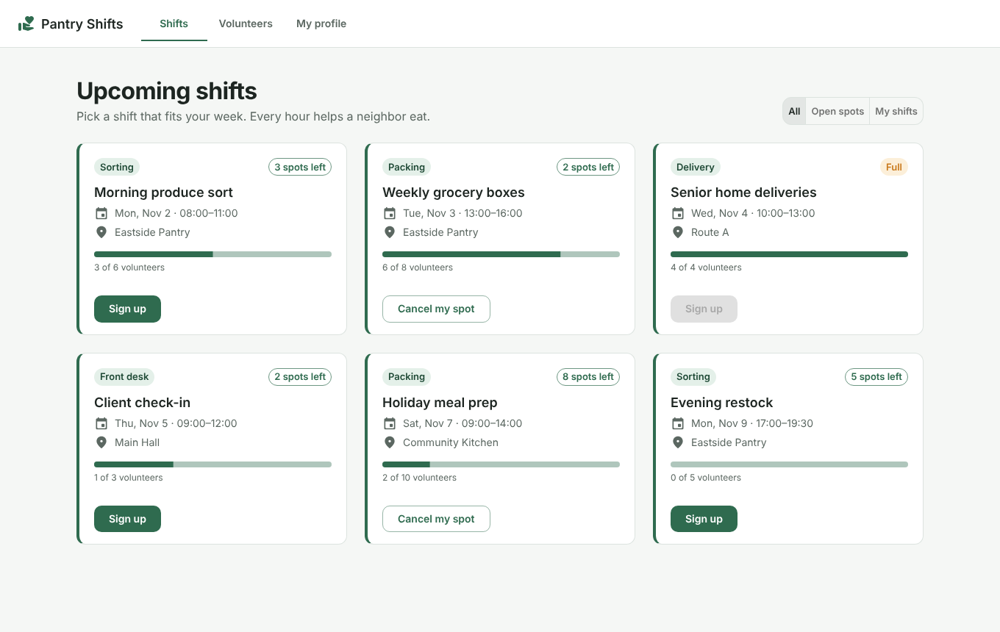
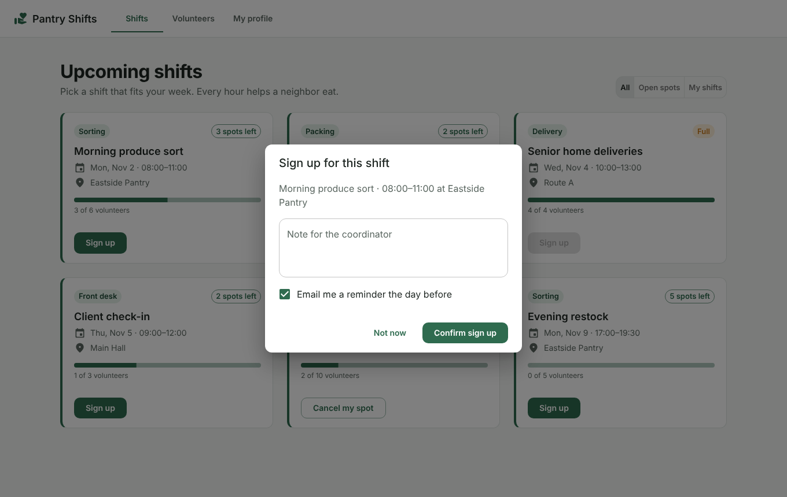
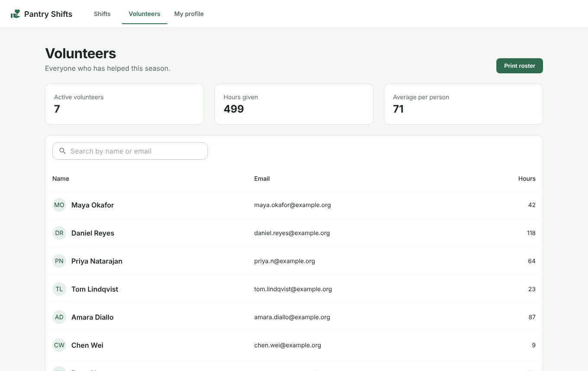
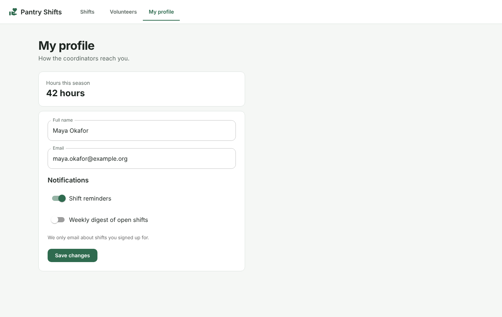

# Pantry Shifts

A small volunteer scheduling app for a neighborhood food pantry. Volunteers browse upcoming shifts, sign up or cancel, see who else has helped, and manage their profile. Built with React 19, TypeScript, Vite and MUI 7. It runs entirely in the browser: no backend, no API keys, and data is kept in `localStorage`.

## Screens

| Shifts | Sign-up dialog |
| --- | --- |
|  |  |

| Volunteers | My profile |
| --- | --- |
|  |  |

## Run it

```bash
npm install
npm run dev      # http://localhost:5173
npm run build    # typecheck + production build
```

Requires Node 18 or newer.

## Project layout

```
src/
  App.tsx            app bar and tab navigation
  theme.ts           MUI theme and color tokens
  data/seed.ts       sample shifts and volunteers
  components/        PageHeader, ShiftCard, StatusChip, SignUpDialog, SummaryTile, InfoTile
  pages/             ShiftsPage, VolunteersPage, SettingsPage
```

## License

MIT. Sample names and emails are fictional.
